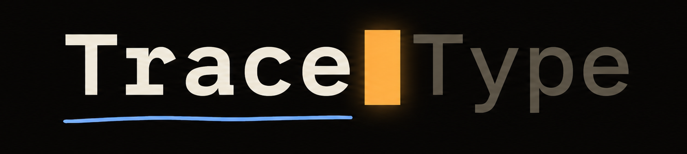
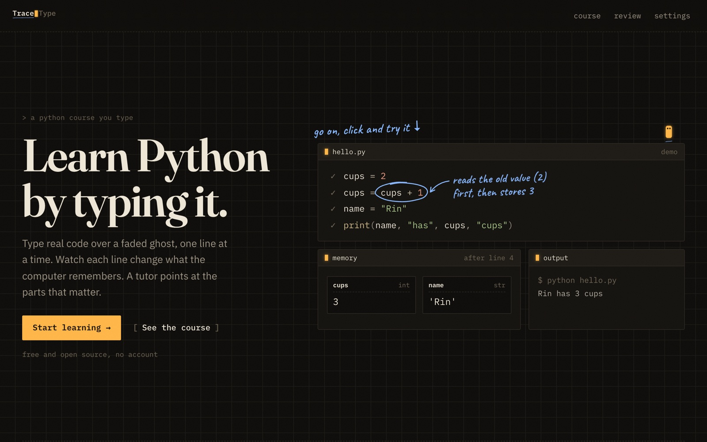
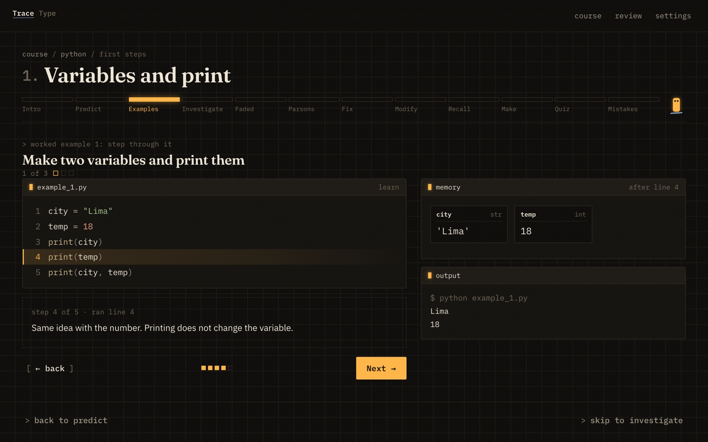

<p align="center">
  
</p>

<p align="center">
  <strong>Learn Python by typing real code while a tutor shows what every line does.</strong>
</p>

<p align="center">
  <a href="https://adityadev12.github.io/tracetype/"><strong>Try it live: adityadev12.github.io/tracetype</strong></a>
  <br>
  Free, open source, no account needed.
</p>

<p align="center">
  
</p>

---

## Contents

- [What it is](#what-it-is)
- [How a lesson works](#how-a-lesson-works)
- [The course path](#the-course-path)
- [Tech stack](#tech-stack)
- [Run locally](#run-locally)
- [How to add a lesson](#how-to-add-a-lesson)
- [Project structure](#project-structure)
- [Roadmap](#roadmap)
- [License](#license)
- [Acknowledgments](#acknowledgments)

## What it is

TraceType is a free Python course that runs entirely in your browser.

- **Type over real code.** You type each line over a faded "ghost" copy, so your hands learn the syntax.
- **See what the computer remembers.** A memory panel shows every variable appear and change, line by line.
- **A tutor marks it up.** Hand-drawn circles, arrows and notes point at the exact part of a line that matters.
- **Real Python, no install.** Your code runs in [Pyodide](https://pyodide.org/) inside a Web Worker, with a time limit so an infinite loop never freezes the page.
- **Practice comes back.** Finished exercises return for spaced review, so you remember them weeks later.
- **No account.** Progress, XP and streaks live in your browser and can be exported and imported.

## How a lesson works

<p align="center">
  
</p>

Each lesson teaches one idea in about 15 to 25 minutes, in 12 steps:

| # | Step | What you do |
|---|---|---|
| 1 | Intro | Read a short explanation with one everyday analogy |
| 2 | Predict | Guess what some code prints, then watch it run |
| 3 | Worked examples | Step through 3 examples, then type each one over its ghost |
| 4 | Investigate | Answer quick questions about specific lines |
| 5 | Faded code | Fill in the blanks in similar code |
| 6 | Parsons | Put shuffled lines back in order |
| 7 | Fix the bug | Find and fix one mistake, checked by running it |
| 8 | Modify | Change working code so it does something new |
| 9 | Recall | Write a worked example from memory |
| 10 | Make | Write a small new program from a plain description |
| 11 | Quiz | Multiple choice, each answer with a one-line "why" |
| 12 | Common mistakes | See typical beginner errors and the real error messages |

**Built on PRIMM.** The order follows Predict, Run, Investigate, Modify, Make, a lesson structure from computing education research. Worked examples fade into blanks, then into a blank page.

**Kind grading.** Code is checked by meaning, not formatting: spaces and quote style do not matter. Retries are unlimited. After 2 wrong tries a "Show answer" button appears, and only using it marks an item as weak.

**Spaced review.** Predict, Faded, Fix, Recall and Make items become review cards. They come back after 1, 3, 7, 14, 30 and 60 days, mixed with cards from other lessons. Each unit also ends with a mini project and a mixed unit review.

## The course path

Four tracks, learned in order. Each track is made of units, and each unit of lessons.

| # | Track | What you learn | Status |
|---|---|---|---|
| 1 | **Python** | The language itself, from your first variable to functions, classes and files | Live |
| 2 | **Python for Data Analysis** | NumPy, pandas and plots on real tables of data | Coming soon |
| 3 | **Data Science from Scratch** | Statistics, regression and a tiny neural network, built by hand | Coming soon |
| 4 | **Hands-On Machine Learning** | scikit-learn and Keras versions of what you built by hand | Coming soon |

Nothing is hard-locked: the next lesson is highlighted, but you can skip ahead.

## Tech stack

| Part | Tools |
|---|---|
| App | React 19, TypeScript, Vite |
| Code editor | CodeMirror 6 |
| Python in the browser | Pyodide in a Web Worker |
| Offline tracer | Python 3 (`scripts/trace_lesson.py`), sharing one runtime with the browser |
| Tests | Vitest (unit), Playwright (browser, with real Python) |
| Hosting | GitHub Pages, deployed by GitHub Actions on every push to `main` |
| Fonts | Fraunces, IBM Plex Sans, IBM Plex Mono, Caveat |

## Run locally

Needs Node 20+ and Python 3.

```sh
git clone https://github.com/AdityaDev12/tracetype.git
cd tracetype
npm install
npm run dev        # http://localhost:5173/tracetype/
```

| Command | What it does |
|---|---|
| `npm test` | Unit tests (typing engine, traces, grading, lesson schema) |
| `npm run test:e2e` | Browser tests with Playwright (run `npm run build` first) |
| `npm run validate` | Checks every lesson file against the schema and minimum counts |
| `npm run check-links` | Opens every "Read more" link and checks the page and section exist |
| `npm run lint` | ESLint |
| `npm run build` | Production build into `dist/` |
| `npm run trace -- <file.json>` | Runs every program in a lesson and writes its generated data (`--all` for everything) |

## How to add a lesson

Lessons are JSON files in `content/lessons/<track>/`. The format is described in [docs/PLAN.md](docs/PLAN.md) (section 3) and typed in `src/engine/types.ts`. Copy `content/lessons/python/py-01-variables.json` as a starting point.

1. **Write the authored fields:** intro, predict, examples, investigate, faded, parsons, fix, modify, recall, make, quiz, mistakes, links and bookRefs. Leave out every `gen` field.
2. **Add the lesson id** to its unit in `content/units/<track>.json`.
3. **Generate the run data:**
   ```sh
   npm run trace -- content/lessons/python/<id>.json
   ```
   This runs every program with the same runtime the browser uses and writes the `gen` fields. It refuses exercises that do not make sense, such as a bug that passes its tests or a predict answer that is not the real output. Never edit `gen` by hand.
4. **Check it:** `npm run validate` and `npm run check-links`.

All lesson text, code and questions must be original work.

## Project structure

```
content/          tracks, units, lessons, projects, demos, notes
docs/             PLAN.md, DESIGN.md, UNIVERSAL.md, brand/, screenshots/
e2e/              browser tests, including a full lesson with real Python
public/           favicons and logo served with the site
scripts/          trace_lesson.py, validate_lessons.ts, check_links.ts, brand/
src/
  engine/         language neutral logic: types, validation, grading, typing, traces
  languages/      language packs (Python: coloring, runtime.py, Pyodide worker, errors)
  lesson/         lesson page and every exercise type
  pages/          dashboard, course, track tree, review, project, settings
  landing/        landing page and the live hero demo
  design/         terminal panels, the tutor's hand-drawn pen, memory boxes
  progress/       progress, XP, streak, review scheduling, export and import
  brand/          logo and mascot
```

## Roadmap

- [x] **Milestone 1:** typing engine, trace mode, first lesson
- [x] **Milestone 2:** full lesson format, Python in the browser, review system, course pages
- [ ] **Milestone 3:** the complete Python track, unit by unit
- [ ] **Milestone 4:** Python for Data Analysis, with array grids, DataFrame tables and plots
- [ ] **Milestone 5:** Data Science from Scratch, with vectors, fitted lines and gradient descent visuals
- [ ] **Milestone 6:** Hands-On Machine Learning
- [ ] **Later:** more languages (JavaScript, SQL) and community lessons, see [docs/UNIVERSAL.md](docs/UNIVERSAL.md)

## License

- **Code:** [MIT](LICENSE)
- **Lesson content** in `content/` (lessons, projects, notes, syllabus): [CC BY 4.0](LICENSE-CONTENT). Share and adapt it freely, with credit to TraceType.

## Acknowledgments

**Syllabus references.** These books shaped the order of topics. They are used only as references: no text, code or exercises are copied, and lessons link to chapter titles so you know where to read more.

- *Learning Python* by Mark Lutz
- *Python for Data Analysis* by Wes McKinney
- *Data Science from Scratch* by Joel Grus
- *Hands-On Machine Learning with Scikit-Learn, Keras and TensorFlow* by Aurelien Geron

**Open source.**

- [Pyodide](https://pyodide.org/) runs CPython in the browser
- [CodeMirror](https://codemirror.net/) powers the code editor
- [React](https://react.dev/) and [Vite](https://vite.dev/)

**Research behind the lesson design.**

- PRIMM: Sentance and Waite, 2017. [doi.org/10.1145/3137065.3137084](https://doi.org/10.1145/3137065.3137084)
- Faded Parsons problems: Weinman, Fox and Hearst, 2021. [doi.org/10.1145/3411764.3445228](https://doi.org/10.1145/3411764.3445228)
- Test-enhanced learning: Roediger and Karpicke, 2006. [doi.org/10.1111/j.1467-9280.2006.01693.x](https://doi.org/10.1111/j.1467-9280.2006.01693.x)
- Distributed practice: Cepeda and others, 2006. [doi.org/10.1037/0033-2909.132.3.354](https://doi.org/10.1037/0033-2909.132.3.354)
